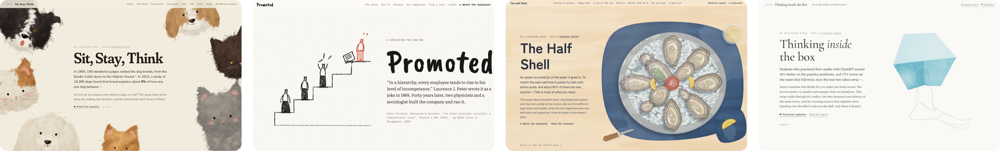

# Explorable

**A Claude skill that turns a question and a picture into an explorable.** You get a researched, illustrated scrollytelling essay drawn in the picture's style, and a short explainer video you can pause and question.



**See them live at [explorables.fly.dev](https://explorables.fly.dev)**: the three examples and more, with videos you can pause and ask (bring your own Anthropic key).

```
/explorable why do oysters taste different in different places?   [attach a style image]
```

The skill:
1. Researches the question with sourced numbers.
2. Finds the story.
3. Builds a drawing engine that paints like your reference image, or starts from one of six built-in styles.
4. Writes the essay chapter by chapter, with a research report every number links to.
5. Makes a ~85-second video in the same style, with a voice, music, and an ask box that answers follow-up questions with new clips.

It checks its own work in headless Chrome as it goes.

## Quick start

```bash
git clone https://github.com/Rrrima/explorables.git ~/.claude/skills/explorable
node ~/.claude/skills/explorable/scripts/gallery.mjs      # open the examples at http://localhost:8900/
```

Then, in Claude Code, from the folder where you want the output:

```
/explorable how does a sourdough starter work? make it feel like a children's picture book   [attach image]
```

## Gallery

| | Style | What's in it |
|---|---|---|
| **Sit, Stay, Think** (`examples/sit-stay-think`) | needle-felted animals, drawn with WebGL | the 1994 breed ranking as felt, the 9% figure as two overlapping clouds of dogs, faces, cats, brains |
| **Promoted** (`examples/promoted`) | crayon | a runnable re-implementation of the Peter principle model (Pluchino et al. 2010): your own company of 160 people on six floors, and which promotion rule wins |
| **The Half Shell** (`examples/half-shell`) | sunlit watercolour | why oysters taste of their water and cost a dollar or a hundred: maps from real coastlines, the months-with-an-R rule, how to tell a good one |

Each example is an `essay/` (static) and a `video/` (the explainer kit). `node scripts/gallery.mjs` serves them all. Set `ANTHROPIC_API_KEY` to ask the videos questions.

## What it makes

- **The essay:** static HTML, CSS and JS; no build step, deployable anywhere.
  - Canvas drawings in the reference's style.
  - Scroll-driven scenes and hover or tap details.
  - Data drawn as things.
  - Phone and landscape layouts.
  - A `report.html` with numbered sources per research track, conflicts and open questions.
- **The video:** drawn live on canvas, so it stays sharp and seekable at any size.
  - Word-timed scenes, narration (ElevenLabs), music (Stable Audio), sound effects and captions.
  - Pause anywhere and ask a question. An agent researches the answer and makes a clip in the same style, with nested follow-ups and a "new take" option.

## Install

The skill is a folder; any Agent Skills host that can read files, search the web and run shell commands can use it.

The repo is private: ask Rrrima for access, then make sure git can sign in to GitHub on your machine (GitHub Desktop, `gh auth login`, or a personal access token).

- **git:** `git clone https://github.com/Rrrima/explorables.git ~/.claude/skills/explorable` (the folder must be named `explorable`). Update later with `git -C ~/.claude/skills/explorable pull`.
- **ZIP:** download, unzip, rename the folder to `explorable`, and move it into `~/.claude/skills/`.

Requirements:
- Node.js 20+.
- Chrome or Chromium, for the screenshot checks.
- ffmpeg, for contact sheets and the audio mix.
- For the video's ask agent, one install: `cd ~/.claude/skills/explorable/kit/server && npm install`.

### Keys

These are read from the environment or a `.env` file in the folder you run Claude Code from:

| Key | For | Without it |
|---|---|---|
| `ANTHROPIC_API_KEY` | the video's ask-a-question agent | the video plays; asking is off |
| `ELEVENLABS_API_KEY`, `ELEVENLABS_VOICE_ID` | narration with word timing, sound effects | you get the essay, plus the video's script and scenes; no audio |
| `STABILITY_API_KEY` | background music | no music |

## Usage

```
/explorable <a topic or a question>    (attach a style reference image, or name a built-in style)
```

Good prompts name what you want covered: "why some are expensive", "how to tell a good one", "the culture around it". The skill turns each ask into a checklist item, and every item must land in a chapter. The image sets the medium, light, palette, texture and drawing vocabulary. A painting, an illustration or a photo of a craft all work. Without an image, name one of the built-in styles (`pen`, `watercolour`, `felt`, `crayon`, `riso`, `fashion-plate`; see `kit/styles/README.md`), or the skill will list them with links to the live examples at [explorables.fly.dev](https://explorables.fly.dev) and ask. Output goes to `./<slug>-scrolly/` and `./<slug>-explainer/`.

A full run takes a while: research with parallel subagents, several drawing and check rounds, then voice and music. Expect an hour or more for both pieces.

## How it works

`SKILL.md` is the workflow; `references/` holds the long guides it loads as needed.

| Phase | Guide |
|---|---|
| Look at the reference; write `STYLE.md` | `references/style.md` |
| Research tracks; `report.html`, `data.js` | `references/research.md` |
| One spine, 6–8 chapters, each a different kind of picture | `references/essay.md` |
| A drawing engine and a **master study** that re-creates a crop of the reference | `references/style.md` |
| The essay, chapter by chapter | `references/essay.md`, `references/house-style.md` |
| Checks: desktop, phone, frame budget | `references/verify.md`, `references/performance.md` |
| Script, audio, scenes in the essay's engine | `references/video.md` |

Under the hood:
- `kit/`: the explainer kit. The player (`kit/player/`), the ask agent (`kit/server/`), the voice, music and mix pipeline (`kit/pipeline/`) and a project template.
- `kit/engines/`: reusable drawing engines (pen, hands, felt fur, WebGL hair, riso, crayon).
- `scripts/`: headless-Chrome checks (`shoot`, `frames`, `stall`) and preview servers.

## Limits

- **It's not a chart library.** Data is drawn in the essay's medium; if you need a dashboard, use a dashboard tool.
- **Quality depends on the reference.** A clear, consistent illustration works best; a busy photo collage gives the engine little to learn from.
- **Facts come from the web and get checked against sources,** but the research is only as good as what's online. Read the report's open questions.
- **The video needs audio keys for its voice.** Without them you get the essay and a silent script.
- **Runs are long and use a lot of model time.**

## Contributing

Issues and pull requests are welcome; see `CONTRIBUTING.md`. New drawing engines (`kit/engines/`) and new examples are especially useful. `evals/evals.json` has the prompts used to check changes to the skill.

## License

MIT. See `LICENSE`.
